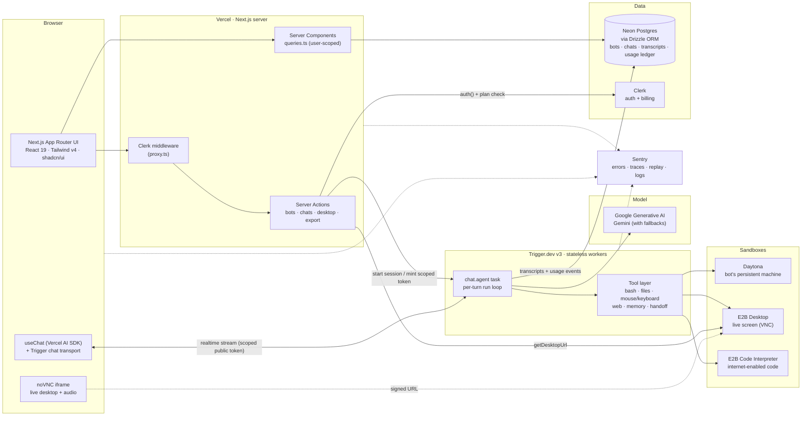

# ai-bots

**AI agents with their own computers.** Every bot has a personality, a long-term memory, a face, and a real sandboxed machine: a terminal, a file system, the open web and a live desktop you can watch and take over. Put several bots in a group chat and they `@mention` and hand work off to each other.

Built as a production-style SaaS: auth, a paid plan, metered usage with limits, background agents and full observability. Everything runs on free tiers.

---

## Features

| | |
| --- | --- |
| **Agentic chat** | Streaming replies with every tool call rendered inline: terminal output, file trees, code, web sources. |
| **Live desktop + Watch Mode** | Each direct chat has a resizable desktop panel (noVNC). When the bot starts using its computer, the panel opens by itself and shows a pulsing *Live* indicator. Click the screen to take control fullscreen. Desktop audio streams in the browser too. |
| **Sandboxes** | Daytona for the bot's persistent machine (bash, files), E2B Desktop for the live screen, E2B Code Interpreter for code that needs the open internet. |
| **Web tools** | Server-side search and page fetching, with SSRF guards (DNS checks, redirect and size limits). |
| **Per-bot memory** | `remember` / `recall` tools give each bot its own durable notes about you. |
| **Group chats** | Pick who answers each turn or `@mention` a bot; bots can hand off a turn to the bot that fits it best. |
| **Starter prompts** | One-click first messages in an empty chat that show the desktop, code, web and memory tools. |
| **Transcript export** | Download any chat as Markdown. The server action only returns chats owned by the signed-in user. |
| **Billing and usage** | Clerk Billing plans gate features; an append-only usage ledger meters tokens, sandbox seconds, searches and fetches against per-plan limits. |
| **Observability** | Sentry errors, tracing, session replay (text and inputs masked) and structured logs across Next.js and Trigger.dev workers. |

---

## Architecture



### Request lifecycle (one chat turn)

1. **Browser → Server Action.** `startChatSession` / `mintChatAccessToken` check the Clerk session and the plan (`bots` + `sandboxes`), and check that the chat belongs to the user. They then return a Trigger.dev public token scoped to that one chat session.
2. **Browser ⇄ Trigger.dev.** `useChat` streams through the Trigger chat transport straight to the worker, so a long agent turn never holds a Vercel function open.
3. **Agent run.** `chat.agent` loads the transcript from Postgres, builds the bot's system prompt (persona, memory, group context) and runs Gemini through the AI SDK with the tools turned on for that bot.
4. **Tools.** Commands and files go to the bot's Daytona sandbox, the desktop is driven over E2B Desktop, internet-enabled code runs in E2B Code Interpreter, and web search/fetch runs on the worker itself.
5. **Persist and meter.** The transcript is saved per chat. Every billable unit (tokens, sandbox seconds, searches, fetches) is appended to `usage_events`, and limits are checked before the next unit is spent.
6. **Live view.** `getDesktopUrl` returns a short-lived signed noVNC URL for the bot's desktop. The panel refreshes it before it expires and opens by itself while the bot uses the computer.

### Isolation

Every query and action is scoped by Clerk `userId` (`queries.ts`, `actions/*`). Trigger.dev tokens are scoped to one chat session. Desktop URLs are only issued for a sandbox that belongs to a bot the user owns.

---

## Tech stack

| Layer | Technology |
| --- | --- |
| Framework | **Next.js 16** (App Router, Server Actions, Turbopack), **React 19** |
| Auth & billing | **Clerk** (`@clerk/nextjs`, Clerk Billing plans and features) |
| Database | **Neon Postgres** (serverless driver) + **Drizzle ORM** / drizzle-kit (push-only), drizzle-zod |
| UI | **Tailwind CSS v4**, **shadcn/ui** (Base UI primitives), AI Elements, lucide icons, DiceBear avatars |
| AI | **Vercel AI SDK** (`ai`, `@ai-sdk/react`), **Google Generative AI** (`@ai-sdk/google`, Gemini) |
| Background agents | **Trigger.dev v3** (`chat.agent`, realtime chat transport) |
| Sandboxes | **E2B** (Desktop + Code Interpreter), **Daytona** |
| Observability | **Sentry** (`@sentry/nextjs`, `@sentry/node` in workers): errors, tracing, replay, logs |
| Hosting | **Vercel** (web), Trigger.dev Cloud (workers) |

### Free-tier notes

- Sentry samples 10% of traces and sessions in production and every session that has an error. Replays mask all text and inputs.
- E2B sandboxes shut down after idling, and Daytona auto-stops idle sandboxes, so nothing runs (or bills) unattended.
- Long agent turns run on Trigger.dev, not Vercel functions, so they stay within Vercel Hobby timeouts.
- Sentry's example page and API route return 404 in production, so the error quota can't be burned by visitors.

---

## Project structure

```
app/                  Routes: (dashboard) home, chats/[chatId], usage, pricing; error + not-found boundaries
actions/              Server Actions: bot, chat, group-chat, desktop, export
components/           App components (chat, sidebar, desktop panel, dialogs)
  ui/  ai-elements/   Vendored shadcn + AI Elements (kept as upstream ships them)
db/                   Drizzle schema + client
lib/                  Billing, usage ledger and limits, sandboxes, desktop, memory, Sentry helpers
trigger/              Trigger.dev tasks: chat agent, tools, model, web, E2B
queries.ts            User-scoped reads for server components
```

---

## Getting started

```bash
npm install
# create .env.local with the variables below
npm run db:push              # apply the Drizzle schema to Neon (push-only, no migrations)
npx trigger.dev dev          # terminal 1: run the agent worker locally
npm run dev                  # terminal 2: http://localhost:3000
```

### Environment variables

| Variable | Where it's used |
| --- | --- |
| `NEXT_PUBLIC_CLERK_PUBLISHABLE_KEY`, `CLERK_SECRET_KEY`, `NEXT_PUBLIC_CLERK_SIGN_IN_URL`, `NEXT_PUBLIC_CLERK_SIGN_UP_URL` | Clerk auth |
| `DATABASE_URL`, `DATABASE_URL_UNPOOLED` | Neon Postgres |
| `GOOGLE_GENERATIVE_AI_API_KEY` | Gemini (Trigger.dev worker) |
| `TRIGGER_SECRET_KEY` | `tr_dev_…` locally, `tr_prod_…` on Vercel. Never mix them |
| `DAYTONA_API_KEY`, `DAYTONA_API_URL` | Daytona sandboxes |
| `E2B_API_KEY` | E2B Desktop and Code Interpreter |
| `SENTRY_DSN` (+ `SENTRY_AUTH_TOKEN` in `.env.sentry-build-plugin`) | Sentry runtime + source map upload |

Worker env vars are read from where the task runs: `.env.local` for `trigger dev`, and the Trigger.dev dashboard for deployed tasks. Vercel env vars don't reach the workers.

### Scripts

| Command | |
| --- | --- |
| `npm run dev` / `build` / `start` | Next.js |
| `npm run typecheck` | `tsc --noEmit` |
| `npm run lint` | ESLint (Next core-web-vitals + TypeScript) |
| `npm run format` | Prettier + Tailwind class sorting |
| `npm run db:push` / `db:studio` | Drizzle schema push / studio |
| `npx trigger.dev deploy` | Deploy the agent worker |
