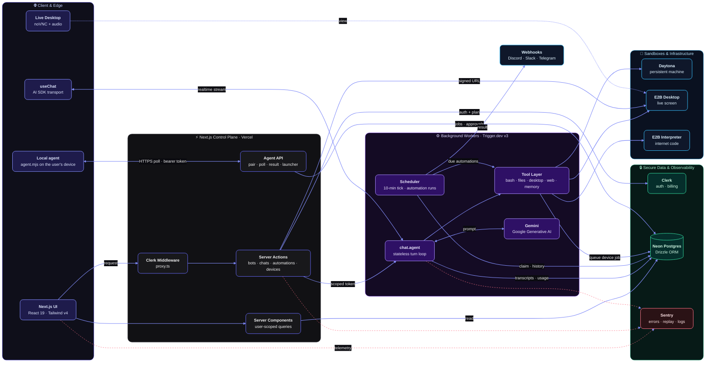

# ai-bots

**AI agents with their own computers.** Every bot has a personality, a long-term memory, a face, and a real sandboxed machine: a terminal, a file system, the open web and a live desktop you can watch and take over. Put several bots in a group chat and they `@mention` and hand work off to each other.

Built as a production-style SaaS: auth, a paid plan, metered usage with limits, background agents and full observability. Everything runs on free tiers.

---

## Features

| | |
| --- | --- |
| **Agentic chat** | Streaming replies with every tool call rendered inline: terminal output, file trees, code, web sources. |
| **Live desktop + Watch Mode** | Each direct chat has a resizable desktop panel (noVNC). When the bot starts using its computer, the panel opens by itself and shows a pulsing *Live* indicator. Click the screen to take control fullscreen. Desktop audio streams in the browser too. |
| **Sandboxes** | Daytona for the bot's persistent machine (bash, files), E2B Desktop for the live screen, E2B Code Interpreter for code that needs the open internet. |
| **Web tools** | Server-side search and page fetching, with SSRF guards (DNS checks, redirect and size limits). |
| **Per-bot memory** | `remember` / `recall` tools give each bot its own durable notes about you. |
| **Group chats** | Pick who answers each turn or `@mention` a bot; bots can hand off a turn to the bot that fits it best. |
| **Automations** | Give a bot a task and a schedule (hourly, daily, weekly, in your time zone). It runs unattended on Trigger.dev with search, page reading, its sandbox and its memory, keeps a run history, and can send the result to a Discord, Slack or Telegram webhook. Six templates: morning briefing, job hunter, price watcher, competitor watch, lead finder, repo digest. |
| **Your PC** | A single-file, dependency-free agent (`public/agent.mjs`) lets bots work on the user's own computer: run a command, read, write and list files, open a link. Scoped to one shared folder, every command approved in the terminal, dangerous commands blocked, token hashed server-side, one click to disconnect. |
| **File deliverables** | `shareFile` puts a download button in the chat for a file the bot made in its sandbox (a report, a CSV of leads, a script). |
| **Public welcome page** | `/welcome` explains the product, the plan and what it replaces to signed-out visitors; `/` sends them there. Copy and plan allowances live in `lib/value.ts`, shared with the pricing page. |
| **No-typing device setup** | The Your PC page hands out a launcher (`.bat` for Windows, a zipped `.command` for Mac, `.sh` for Linux) with the pairing code and folder filled in: download, double-click, done. Commands are approved in the app. |
| **In-app guide** | `/guide` walks users through bots, automations, their own devices, approvals, usage and troubleshooting. |
| **Dashboard home** | Once a user has a bot, `/` is an overview read live from the database: jobs done this month, running and paused automations, latest results, what runs next, usage against the plan, devices, and anything waiting for approval. New users see a three-step start instead. |
| **Editable automations** | Change an automation's task, bot, schedule, device or webhook in place. The saved webhook URL is never sent back to the browser; an empty field keeps it. |
| **Public pages and SEO** | `/welcome`, `/privacy`, `/terms`, a generated Open Graph image, `robots.txt` and `sitemap.xml`. Set `NEXT_PUBLIC_APP_URL` for a custom domain; on Vercel the production URL is picked up by itself. |
| **Starter prompts** | One-click first messages in an empty chat that show the desktop, code, web and memory tools. |
| **Transcript export** | Download any chat as Markdown. The server action only returns chats owned by the signed-in user. |
| **Billing and usage** | Clerk Billing plans gate features; an append-only usage ledger meters tokens, sandbox seconds, searches and fetches against per-plan limits. |
| **Observability** | Sentry errors, tracing, session replay (text and inputs masked) and structured logs across Next.js and Trigger.dev workers. |

---

## Architecture



> **Legend** — <kbd>indigo</kbd> client · <kbd>zinc</kbd> control plane · <kbd>violet</kbd> workers · <kbd>sky</kbd> sandboxes · <kbd>emerald</kbd> data · <kbd>rose ┄</kbd> telemetry to Sentry

### Request lifecycle (one chat turn)

1. **Browser → Server Action.** `startChatSession` / `mintChatAccessToken` check the Clerk session and the plan (`bots` + `sandboxes`), and check that the chat belongs to the user. They then return a Trigger.dev public token scoped to that one chat session.
2. **Browser ⇄ Trigger.dev.** `useChat` streams through the Trigger chat transport straight to the worker, so a long agent turn never holds a Vercel function open.
3. **Agent run.** `chat.agent` loads the transcript from Postgres, builds the bot's system prompt (persona, memory, group context) and runs Gemini through the AI SDK with the tools turned on for that bot.
4. **Tools.** Commands and files go to the bot's Daytona sandbox, the desktop is driven over E2B Desktop, internet-enabled code runs in E2B Code Interpreter, and web search/fetch runs on the worker itself.
5. **Persist and meter.** The transcript is saved per chat. Every billable unit (tokens, sandbox seconds, searches, fetches) is appended to `usage_events`, and limits are checked before the next unit is spent.
6. **Live view.** `getDesktopUrl` returns a short-lived signed noVNC URL for the bot's desktop. The panel refreshes it before it expires and opens by itself while the bot uses the computer.

### How a command reaches the user's own computer

1. **Pairing.** The Your PC page creates a one-time code (stored only as a SHA-256 hash, valid 10 minutes) and offers a launcher file with the code filled in. The agent trades the code for a random token; the server keeps only the token's hash.
2. **Queue, don't connect.** A `pc*` tool inserts a row in `device_jobs`. The agent polls over outbound HTTPS, so it works behind any router or firewall and the server never opens a connection into the user's machine.
3. **Approval.** Commands and "open" start as `awaiting_approval`; the agent cannot see them until the user clicks Allow in the app (or has switched asking off for that device). File work inside the shared folder skips this step.
4. **Run and report.** The agent claims one job at a time (an atomic `pending → running` update, so a job is never handed out twice), enforces the shared folder and the block-list locally, and posts the result back.

### Design decisions and fault tolerance

| Decision | Why |
| --- | --- |
| **One cron tick starts every due automation** | A single Trigger.dev schedule serves any number of automations. The tick moves `next_run_at` forward with a conditional update before it triggers the run, so overlapping ticks can't start the same run twice. |
| **Runs never retry automatically** | A retry would bill, act and deliver twice. A failed run is recorded and the next scheduled time tries again. |
| **Self-pausing automations** | Three failed runs in a row pause the automation and notify the webhook, so a broken task can't drain a user's allowance. |
| **Stale-run sweep** | Each tick closes runs whose worker died (still "running" after 15 minutes) and prunes old job and run rows to keep the database small. |
| **Jobs expire instead of running late** | A device job nobody picked up in 60 seconds, or nobody approved in 2 minutes, is dropped. A command never runs long after the bot moved on. |
| **Polling, not sockets, for the local agent** | Works on Vercel's serverless functions and through any NAT. The agent backs off when the server is unreachable and resumes by itself. |
| **Model fallback** | Gemini models are tried in order with a one-minute cool-down for a refused model, so a rate-limited free tier degrades instead of failing. |
| **Append-only usage ledger** | The web server and the workers both write usage rows and never update them, so they can't conflict; limits are a sum over the period. |
| **Secrets stay hashed or hidden** | Pairing codes and agent tokens are stored as hashes; webhook URLs are only ever shown by host name; commands on the PC run without secret-looking environment variables. |
| **Fail closed on the user's machine** | Unknown job kinds, paths outside the shared folder (including through symlinks) and blocked commands are refused by the agent itself, whatever the server says. |

### Isolation

Every query and action is scoped by Clerk `userId` (`queries.ts`, `actions/*`). Trigger.dev tokens are scoped to one chat session. Desktop URLs are only issued for a sandbox that belongs to a bot the user owns.

---

## Tech stack

| Layer | Technology |
| --- | --- |
| Framework | **Next.js 16** (App Router, Server Actions, Turbopack), **React 19** |
| Auth & billing | **Clerk** (`@clerk/nextjs`, Clerk Billing plans and features) |
| Database | **Neon Postgres** (serverless driver) + **Drizzle ORM** / drizzle-kit (push-only), drizzle-zod |
| UI | **Tailwind CSS v4**, **shadcn/ui** (Base UI primitives), AI Elements, lucide icons, DiceBear avatars |
| AI | **Vercel AI SDK** (`ai`, `@ai-sdk/react`), **Google Generative AI** (`@ai-sdk/google`, Gemini) |
| Background agents | **Trigger.dev v3** (`chat.agent`, realtime chat transport) |
| Sandboxes | **E2B** (Desktop + Code Interpreter), **Daytona** |
| Observability | **Sentry** (`@sentry/nextjs`, `@sentry/node` in workers): errors, tracing, replay, logs |
| Hosting | **Vercel** (web), Trigger.dev Cloud (workers) |

### Free-tier notes

- Sentry samples 10% of traces and sessions in production and every session that has an error. Replays mask all text and inputs.
- E2B sandboxes shut down after idling, and Daytona auto-stops idle sandboxes, so nothing runs (or bills) unattended.
- Long agent turns run on Trigger.dev, not Vercel functions, so they stay within Vercel Hobby timeouts.
- Automations use one Trigger.dev schedule in total (a tick every 10 minutes that starts whatever is due), however many automations users create, so the free plan's schedule limit is never an issue.
- A running Your PC agent polls every 4 seconds while idle (every second while a bot is working), which keeps Neon awake for as long as someone leaves it running.
- Sentry's example page and API route return 404 in production, so the error quota can't be burned by visitors.

---

## Project structure

```
app/                  Routes: welcome, privacy, terms (public), (dashboard) home, chats/[chatId], automations, pc, guide, usage, pricing; api/agent (pair, poll, result, launcher)
actions/              Server Actions: bot, chat, group-chat, desktop, export, automation, device, files
public/agent.mjs      The Your PC agent users download and run with Node.js
components/           App components (chat, sidebar, desktop panel, dialogs)
  ui/  ai-elements/   Vendored shadcn + AI Elements (kept as upstream ships them)
db/                   Drizzle schema + client
lib/                  Billing, usage ledger and limits, sandboxes, desktop, memory, devices (Your PC), schedule, webhook, Sentry helpers
trigger/              Trigger.dev tasks: chat agent, tools, model, web, E2B, automation (tick + run)
queries.ts            User-scoped reads for server components
```

---

## Getting started

```bash
npm install
# create .env.local with the variables below
npm run db:push              # apply the Drizzle schema to Neon (push-only, no migrations)
npx trigger.dev dev          # terminal 1: run the agent worker locally
npm run dev                  # terminal 2: http://localhost:3000
```

After pulling changes that touch `db/schema.ts` or `trigger/`, run `npm run db:push` and, for production, `npx trigger.dev deploy`. Automations only fire while a worker is running (`trigger dev` locally, a deployed worker in production).

### Your PC agent

Users connect a computer from the **Your PC** page: it shows a one-time pairing code and two commands (download `agent.mjs`, start it with the code and a `--folder`). What the agent enforces on the user's machine:

- File tools only work inside the shared folder (symlinks that point outside are refused), and it refuses to share a whole home folder or drive.
- Every command and every "open" waits for the user's **Allow** in the app (a bar above the chat box, and on the Your PC page); nothing is typed in the terminal. A per-device switch, "Run commands without asking me", turns asking off for unattended automations. `--confirm` adds a terminal prompt on top. Either way a block-list (sudo, disk formatting, credential files, saved passwords, `curl | sh`, persistence) still applies. The block-list is a seat belt, not a sandbox: the approval prompt is the real control.
- Secret-looking environment variables are not passed to commands. The token lives in `~/.ai-bots-agent.json` (mode 600); the server only stores its SHA-256.
- Bots only get the `pc*` tools while the owner's agent is online, never in scheduled runs, and the system prompt tells them web content is never an instruction.

Beyond a single computer:

- **Connection time.** When pairing, the user picks how long the device stays connected (1 hour, 1 day, 7 days, 30 days, or until they disconnect). After that the token stops working by itself.
- **Several devices.** Up to five at once. `listPcs` shows the bot which are online, and every `pc*` tool takes a device name, so a bot can read a file on one and write it on another (text files only).
- **Android.** The agent runs inside Termux (`pkg install nodejs`). There is no iPhone agent.
- **Automations on a device.** An automation can be set to run on one of the user's devices. It then gets the `pc*` tools for that device; if the device is offline at run time the run fails with a clear message instead of doing the task somewhere else. Commands still need approval, so unattended command runs need the agent started with `--yes`.

### Environment variables

| Variable | Where it's used |
| --- | --- |
| `NEXT_PUBLIC_CLERK_PUBLISHABLE_KEY`, `CLERK_SECRET_KEY`, `NEXT_PUBLIC_CLERK_SIGN_IN_URL`, `NEXT_PUBLIC_CLERK_SIGN_UP_URL` | Clerk auth |
| `DATABASE_URL`, `DATABASE_URL_UNPOOLED` | Neon Postgres |
| `GOOGLE_GENERATIVE_AI_API_KEY` | Gemini (Trigger.dev worker) |
| `TRIGGER_SECRET_KEY` | `tr_dev_…` locally, `tr_prod_…` on Vercel. Never mix them |
| `DAYTONA_API_KEY`, `DAYTONA_API_URL` | Daytona sandboxes |
| `E2B_API_KEY` | E2B Desktop and Code Interpreter |
| `SENTRY_DSN` (+ `SENTRY_AUTH_TOKEN` in `.env.sentry-build-plugin`) | Sentry runtime + source map upload |

Worker env vars are read from where the task runs: `.env.local` for `trigger dev`, and the Trigger.dev dashboard for deployed tasks. Vercel env vars don't reach the workers.

### Scripts

| Command | |
| --- | --- |
| `npm run dev` / `build` / `start` | Next.js |
| `npm run typecheck` | `tsc --noEmit` |
| `npm run lint` | ESLint (Next core-web-vitals + TypeScript) |
| `npm run format` | Prettier + Tailwind class sorting |
| `npm run db:push` / `db:studio` | Drizzle schema push / studio |
| `npx trigger.dev deploy` | Deploy the agent worker |
